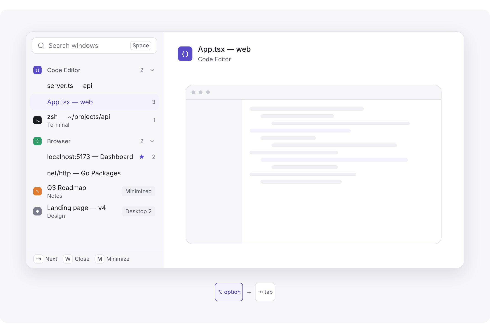

<p align="center">
  
</p>

<h1 align="center">Windeck · 窗签</h1>

<p align="center">
  <b>Switch windows on macOS like browser tabs.</b><br>
  A window switcher for Mac: hold <kbd>⌥</kbd> and press <kbd>Tab</kbd> to see every window as a readable tab, grouped by app, with a large preview.
</p>

<p align="center">
  <a href="https://github.com/chaseFunny/windeck/releases/latest/download/Windeck-arm64.dmg"><b>Download for macOS</b></a> ·
  <a href="https://windeck.islumi.com">Website</a> ·
  <a href="README.zh-CN.md">中文说明</a>
</p>

<p align="center">
  
</p>

## Why Windeck

macOS's <kbd>⌘</kbd> <kbd>Tab</kbd> switches **apps**, not windows. With three browser windows, two editors and a terminal open, finding the right one means guessing between icons. Windeck is an **Alt-Tab for Mac** that switches **windows**, the way you switch tabs in a browser:

- **Full titles, grouped by app.** A vertical tab bar keeps every window title readable; apps with several windows fold into a group.
- **A large preview.** The highlighted window shows big, so two similar windows never get mixed up.
- **Every window, wherever it is.** Minimized, hidden, full-screen, on another desktop (Space) or another display: all listed, each with a badge saying where.
- **Places that stay put.** Apps and windows keep their place in the list; only the highlight moves.
- **Act without leaving.** <kbd>W</kbd> closes a window, <kbd>M</kbd> minimizes it, <kbd>Q</kbd> quits its app.
- **Search.** Press <kbd>Space</kbd> and type a few letters of any title.

## How it works

| Keys | What happens |
|---|---|
| <kbd>⌥</kbd> <kbd>Tab</kbd>, quick tap | Back to the previous window. Nothing shows on screen. |
| Hold <kbd>⌥</kbd>, press <kbd>Tab</kbd> | The tabs appear. <kbd>Tab</kbd> walks your recent windows, arrows walk the list. Release to switch. |
| <kbd>⌥</kbd> <kbd>Tab</kbd>, then <kbd>Space</kbd> | Search: type, then <kbd>Return</kbd>. |

You can keep the system's <kbd>⌘</kbd> <kbd>Tab</kbd> for apps and use <kbd>⌥</kbd> <kbd>Tab</kbd> for windows (recommended), or let Windeck take over <kbd>⌘</kbd> <kbd>Tab</kbd>. All keys: [docs/shortcuts.md](docs/shortcuts.md).

## Smart, never in the way

- The first <kbd>Tab</kbd> is **always** the previous window. A blind tap goes back, every time.
- The second place is the window you usually go to next, marked with a small star.
- Search ranks the same letters by how often and how lately you use each window.

Learned on your Mac only. More: [docs/smart.md](docs/smart.md).

## Privacy

- Window titles, pictures, file names and app lists **never leave your Mac**.
- A privacy list: password managers and banking apps are never captured, by default.
- One click forgets everything learned and every picture kept.
- The local data format is documented: [docs/data.md](docs/data.md).

## Install

1. [Download Windeck-arm64.dmg](https://github.com/chaseFunny/windeck/releases/latest/download/Windeck-arm64.dmg) and drag **Windeck** to **Applications**.
2. Open it. This first version is not notarized by Apple yet, so macOS may say it cannot check the app: open **System Settings → Privacy & Security** and click **Open Anyway**, or run
   ```sh
   xattr -dr com.apple.quarantine /Applications/Windeck.app
   ```
3. Allow **Accessibility** when Windeck asks (needed to list and switch windows). **Screen Recording** is optional and only shows previews.
4. Choose your shortcut and start switching.

Requirements: macOS 13 Ventura or later, Apple silicon. More: [docs/quick-start.md](docs/quick-start.md).

## Pricing

Free to switch: tabs, previews, quick switch, search, and every kind of window. **Windeck Pro** adds the predicted window and habit-ranked search; every install starts with a 14-day Pro trial.

## FAQ

**Is it an Alt-Tab / AltTab alternative for Mac?** Yes: Windeck switches between individual windows, like Alt-Tab on Windows, with titles grouped by app and a large preview.

**Does it replace ⌘Tab?** Your choice: keep ⌘Tab for apps and use ⌥Tab for windows, or take over ⌘Tab.

**Why does it need Accessibility?** To list your windows, bring one forward, and hear the shortcut being held and released. Every window switcher on macOS needs it.

**Is Screen Recording required?** No. Without it, Windeck shows titles only.

**Does it tile or arrange windows?** No. Windeck is for the usual stacked windows of macOS.

**Where are bug reports and ideas?** In [Issues](https://github.com/chaseFunny/windeck/issues).

## Build from source

Windeck is a [MyGo](https://github.com/egoist/mygo) app: pure Go, no cgo, no Electron, with a native GPU-drawn UI. It needs Go 1.27+ and macOS to run.

```sh
go tool mygo dev          # run Windeck Dev with live reload
go tool mygo build        # build/darwin-arm64/Windeck.app and the .dmg
go test ./...             # unit tests
bun install && bun run --cwd website dev   # the website
```

Start with [docs/architecture.md](docs/architecture.md). Windeck needs the Accessibility permission, and Screen Recording for previews; a `go run .` from a terminal that has them inherits them. Release builds are signed with a certificate and an update key that stay off this repository; set `macos.signingIdentity` and `updates` in `mygo.json` to your own.

## License

[MIT](LICENSE). The fonts in `resources/fonts` are under the SIL Open Font License.

---

Windeck is made by [hz](https://github.com/hz7002). Website: [windeck.islumi.com](https://windeck.islumi.com).

<sub>Keywords: macOS window switcher, Mac window switcher, Alt Tab for Mac, AltTab alternative, Cmd Tab alternative, switch between windows on Mac, window manager for macOS, Mission Control alternative.</sub>
